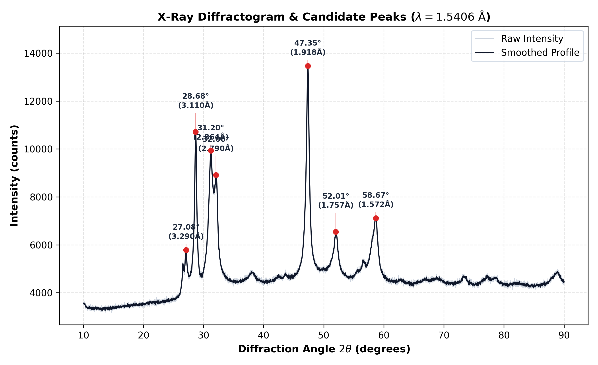

# XRD Bragg Analyzer: Diffractometer Signal Processing & Lattice Spacing Toolkit

[](https://www.python.org/)
[](https://opensource.org/licenses/MIT)
[](https://scipy.org/)

A focused Python computing toolkit for X-ray diffraction (XRD) signal processing. It reads raw diffractometer data (including proprietary Rigaku binary `.raw` files and columnar ASCII formats), applies Savitzky-Golay smoothing, detects candidate peaks via adaptive prominence, calculates interplanar lattice spacings ($d$-spacings) using Bragg's Law, and generates publication-grade plots for manual phase interpretation.

> [!NOTE]
> This toolkit focuses on data preprocessing, candidate peak extraction, and lattice spacing calculation. It does not perform automated crystallographic phase identification or $(hkl)$ Miller index assignments, which require manual matching against reference databases (e.g., COD/ICDD cards).

---

## 🔬 Scientific Principles

### 1. Bragg's Law
Constructive interference from parallel crystal lattice planes is calculated using **Bragg's Law**:

$$n\lambda = 2d \sin\theta \quad \Longrightarrow \quad d = \frac{\lambda}{2 \sin\theta}$$

Where:
* $d$: Interplanar lattice spacing ($\text{Å}$)
* $\lambda$: Incident X-ray radiation wavelength (Default: $\text{Cu } K\alpha = 1.54060\text{ Å}$)
* $\theta$: Bragg angle ($\text{rad}$, half of the measured detector angle $2\theta$)
* $n$: Order of reflection (assumed $n = 1$)

### 2. Signal Smoothing & Peak Detection
* **Savitzky-Golay Filter**: Convolutional polynomial smoothing ($k=3, w=11$) reduces high-frequency detector noise while preserving peak height and position.
* **Adaptive Prominence**: Automatically sets peak prominence threshold to 5% of the intensity dynamic range ($\max - \min$), avoiding spurious noise detection on high-baseline datasets.
* **Net Relative Intensity**: Measures peak height above local background baseline ($I - I_{\min}$) normalized against the maximum peak ($I / I_{\max} \times 100\%$).

---

## 🚀 Key Features

* **Rigaku Binary & ASCII Input**:
  * Native byte parser extracting angle boundaries and float32 count arrays from Rigaku `.raw` files.
  * Delimited text parser for ASCII formats (`.xy`, `.txt`, `.csv`, `.dat`).
* **Candidate Peak Extraction**:
  * Angular centroid location ($2\theta$).
  * Interplanar lattice spacing $d$ ($\text{Å}$).
  * Net relative intensity calculation.
* **Visual Diffractogram Generation**:
  * Displays raw counts, smoothed curve, and labeled candidate peaks without visual overlap.
* **Dual Interface**: Full CLI utility and modular Python functions.

---

## 📊 Sample Diffractogram

Sample output generated from `sample_xrd_data.txt` (8,001 data points, $2\theta = 10^\circ \text{--} 90^\circ$):



```text
=================================================================
Peak #  2-Theta (°)    d-spacing (Å)     Counts      I/I0 (%)  
-----------------------------------------------------------------
1       27.080         3.2901            5787.9      24.9      
2       28.680         3.1101            10712.4     73.0      
3       31.200         2.8644            9929.4      65.4      
4       32.060         2.7895            8910.9      55.4      
5       47.350         1.9183            13470.0     100.0     
6       52.010         1.7569            6544.9      32.3      
7       58.670         1.5723            7115.6      37.9      
=================================================================
```

---

## 🛠️ Installation

```bash
git clone https://github.com/xuexuennn-dev/xrd-bragg-analyzer.git
cd xrd-bragg-analyzer
pip install -r requirements.txt
```

---

## 💻 Usage

### Command Line Interface (CLI)

```bash
# Basic run with automatic adaptive prominence:
python xrd_analyzer.py sample_xrd_data.txt --output xrd_analysis.png

# Custom wavelength and export candidate peak table:
python xrd_analyzer.py sample_xrd_data.txt -w 1.5406 -o analysis.png --out-txt peaks.txt
```

#### Arguments:
* `input_file`: Path to raw XRD file (`.raw`, `.txt`, `.xy`, `.csv`).
* `--wavelength`, `-w`: Incident wavelength in $\text{Å}$ (default: `1.5406`).
* `--prominence`, `-p`: Manual prominence threshold (default: adaptive 5% of dynamic range).
* `--distance`, `-d`: Minimum angular separation in data points (default: `20`).
* `--output`, `-o`, `--out-plot`: Path to save exported plot (default: `xrd_analysis_plot.png`).
* `--out-txt`: Optional path to export TSV peak table.

---

### Python API

```python
from xrd_analyzer import load_xrd_data, analyze_xrd, plot_xrd

# 1. Load data
two_theta, intensity = load_xrd_data("sample_xrd_data.txt")

# 2. Extract candidate peaks and calculate d-spacings
results = analyze_xrd(two_theta, intensity, wavelength=1.5406)

# 3. Print extracted peaks
for p in results['peak_records']:
    print(f"2θ: {p['2theta_deg']:.3f}° | d: {p['d_spacing_A']:.4f} Å | Relative: {p['relative_intensity_pct']:.1f}%")

# 4. Generate annotated plot
plot_xrd(results, save_path="xrd_result.png")
```

---

## 📁 Repository Structure

```
xrd-bragg-analyzer/
├── sample_xrd_data.txt    # Experimental diffractometer scan (8001 data points)
├── requirements.txt       # Dependencies (numpy, scipy, matplotlib)
├── xrd_analyzer.py        # Core parser, peak detection & visualization CLI
├── xrd_example.png        # Sample rendered plot
└── README.md              # Technical documentation
```

---

## 👤 Author

**Ye Xu**
* GitHub: [@xuexuennn-dev](https://github.com/xuexuennn-dev)
* LinkedIn: [Ye Xu](https://www.linkedin.com/in/ye-xu-guet/)